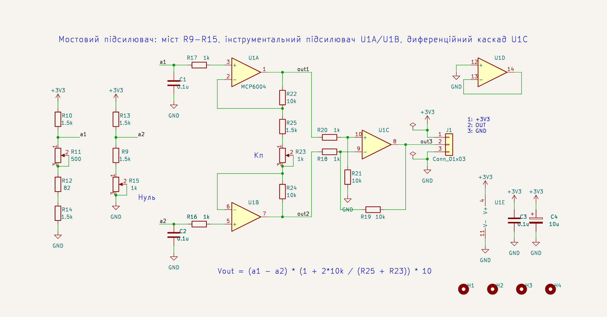
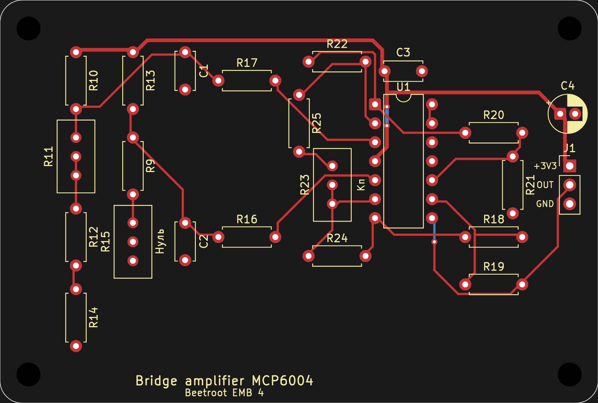

# Мостовий підсилювач (KiCad)

Схема й двошарова друкована плата підсилювача сигналу з резистивного моста: міст → інструментальний підсилювач на двох ОП → диференційний каскад. Проєкт для KiCad 10.

## Як працює схема

- **Міст** R10/R11+R12+R14 (ліве плече) і R13/R9+R15 (праве плече) живиться від 3,3 В. R11 імітує датчик, R15 («Нуль») балансує міст. Сигнали плечей — `a1` і `a2`.
- **RC-фільтри** R17/C1 і R16/C2 (1 кОм, 0,1 мкФ, ≈1,6 кГц) зрізають наводки на входах.
- **Вхідний каскад** U1A/U1B — класичний інструментальний підсилювач: R22 = R24 = 10 кОм, підсилення задає ланцюжок R25 + R23 («Кп») між інвертувальними входами: `1 + 2·10k / (R25 + R23)`, від 9 до ≈14,3.
- **Диференційний каскад** U1C (R18 = R20 = 1 кОм, R19 = R21 = 10 кОм) віднімає `out1 − out2` з підсиленням 10 і дає однополярний вихід `out3`.
- Загалом `Vout = (a1 − a2) · (1 + 2·10k / (R25 + R23)) · 10`, тобто від 90 до ≈143.

Операційний підсилювач — **MCP6004** (чотири ОП в одному корпусі DIP-14, rail-to-rail вхід і вихід, живлення 1,8–6 В), тож усе працює від 3,3 В. Четвертий ОП (U1D) не використовується і ввімкнений повторювачем із входом на GND, щоб не збуджувався.

## Плата

- 80 × 54 мм, 2 шари, усі компоненти вивідні (THT), 4 отвори M3 по кутах.
- Сигнал іде зліва направо, як на схемі: міст → фільтри → U1 → диференційний каскад → роз'єм J1.
- Доріжки майже всі на верхньому шарі (сигнальні 0,3 мм, живлення 0,5 мм). Нижній шар — суцільний полігон GND, на верхньому полігон GND заповнює вільне місце. Перехідних отворів — 3.
- C3 (0,1 мкФ) стоїть біля U1, C4 (10 мкФ) — біля роз'єму живлення.
- Підстроювальні резистори Bourns 3296W: R11 (датчик), R15 («Нуль»), R23 («Кп»).

**J1** (гребінка 2,54 мм): 1 — +3V3, 2 — OUT (вихід `out3`, наприклад на АЦП ESP32/STM32), 3 — GND.

## Перевірка

- ERC схеми: 0 помилок і попереджень.
- DRC плати зі звіркою зі схемою: 0 порушень, 0 непідключених виводів, 0 розбіжностей.
- Netlist схеми автоматично звіряється зі схемою зі скріну уроку (`scripts/check_net.py`).

## Структура

- `Amplifier.kicad_pro`, `Amplifier.kicad_sch`, `Amplifier.kicad_pcb` — проєкт KiCad
- `docs/` — зображення схеми й плати, PDF схеми
- `scripts/` — генерація проєкту:
  - `gen_sch.py` — схема (розміщення символів і дротів)
  - `place.py` — розміщення компонентів на платі
  - `router.py` — трасувальник доріжок (A* на сітці 0,3175 мм, 2 шари, перевірка зазорів)
  - `gen_pcb.py` — плата через Python API KiCad (`pcbnew`)
  - `build.sh` — повна збірка з ERC/DRC (macOS, KiCad 10, для PNG потрібен Google Chrome)
